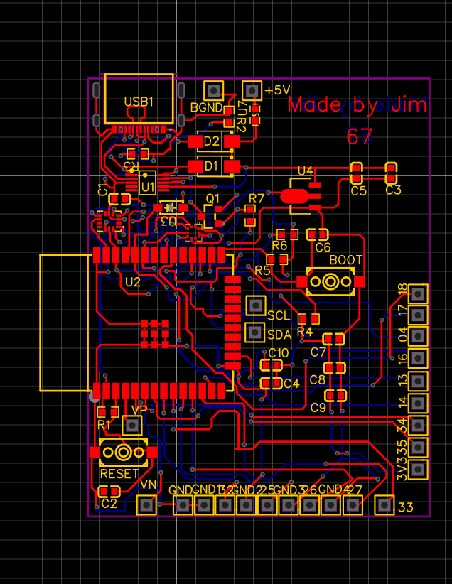
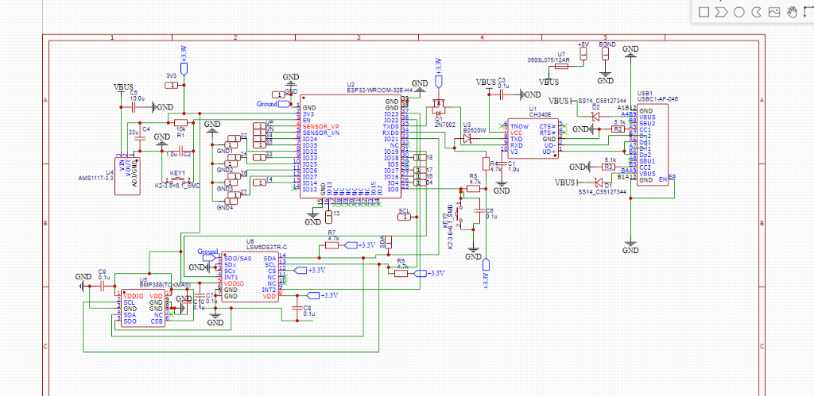

# ESP32 DIY Drone Flight Controller (FC) 🛸

A custom, low-cost drone flight controller development board designed in **EasyEDA Standard (v6.5.51)** around the **ESP32-WROOM-32E** module. Built as my first ever PCB, aimed at hobby quadcopter / multirotor development and 2-layer fabrication via **JLCPCB**.

> **Status:** Rev 1 design complete and Gerbers/BOM/CPL exported. Hardware not yet assembled, so the firmware below is a **bring-up test**, not a flight stack. See [Known limitations](#%EF%B8%8F-known-limitations--rev-11-plans).

---

## 📸 Hardware Overview

| PCB Routing & Layout | Schematic Capture |
| :---: | :---: |
|  |  |

---

## ✨ Key Features & Specifications

- **Microcontroller**: Espressif **ESP32-WROOM-32E-H4** (dual-core 240 MHz, Wi-Fi & Bluetooth, onboard antenna).
- **IMU**: STMicroelectronics **LSM6DS3TR-C** 6-axis gyro + accelerometer.
  - I2C address `0x6A` (SA0 tied to GND), CS tied to 3V3 to select I2C mode.
  - INT1 → `IO19`, INT2 → `IO23`.
- **Barometer**: Bosch **BMP388** (Tokmas C54582187).
  - Shared I2C bus, address `0x76` (SDO tied to GND).
- **USB-UART**: WCH **CH340E** over a **USB-C** receptacle.
  - 5 V ↔ 3.3 V level shifting: **2N7002** (Q1) on ESP TX → CH340E RX, **B0520W** Schottky (U3) on CH340E TX → ESP RX.
  - 5.1 kΩ CC pulldowns (R2, R3) so USB-C hosts supply 5 V.
  - ⚠️ The CH340E has no DTR/RTS pins, so there is **no auto-reset**. Flashing needs the BOOT/RESET button sequence (see [firmware/README.md](firmware/README.md#flashing)).
- **Power**:
  - 5 V from USB-C, or external **5 V** on the `B+` / `B-` pads through a **0603L075/12AR** PTC fuse (U7, 750 mA hold). USB-C VBUS enters through two **SS14** Schottky diodes (D1, D2).
  - 3.3 V rail from an **AMS1117-3.3** LDO (U4).
  - 🔴 **5 V only on `B+`.** Do not connect a 2S/3S LiPo directly. Motors/ESCs are powered off-board.
- **Expansion**:
  - 4-pin I2C header (`3V3`, `SDA`, `SCL`, `GND`).
  - 2.54 mm headers for motor signals, battery/current sense and spare GPIOs.

---

## 📌 Pinout & Hardware Mapping

The same table lives in code as [`firmware/bringup/pins.h`](firmware/bringup/pins.h). PCB net names are `U2_<module pin>` (e.g. `U2_33` = module pin 33 = GPIO21).

### Motor outputs (PWM / DShot / OneShot)
| Function | ESP32 GPIO | Module pin | Description |
| :--- | :--- | :--- | :--- |
| Motor 1 | `IO25` | 10 | ESC signal 1 |
| Motor 2 | `IO26` | 11 | ESC signal 2 |
| Motor 3 | `IO27` | 12 | ESC signal 3 |
| Motor 4 | `IO32` | 8  | ESC signal 4 |

### Sensor bus (I2C) and IMU interrupts
| Line | ESP32 GPIO | Module pin | Notes |
| :--- | :--- | :--- | :--- |
| **SDA** | `IO21` | 33 | 4.7 kΩ pull-up to 3V3; LSM6DS3TR-C, BMP388, external header |
| **SCL** | `IO22` | 36 | 4.7 kΩ pull-up to 3V3; LSM6DS3TR-C, BMP388, external header |
| **IMU INT1** | `IO19` | 31 | LSM6DS3TR-C INT1 |
| **IMU INT2** | `IO23` | 37 | LSM6DS3TR-C INT2 |

### Analog inputs (header only, external divider required)
| Function | ESP32 GPIO | Module pin | Type |
| :--- | :--- | :--- | :--- |
| **BATT_SENSE** | `IO34` | 6 | Input-only, ADC1 |
| **CURR_SENSE / AUX** | `IO35` | 7 | Input-only, ADC1 |

### Spare GPIO headers
`IO36`, `IO39` (input-only), `IO33`, `IO18`, `IO17`, `IO16`, `IO14`, `IO13`, `IO4`.
Strapping pins `IO2`, `IO12`, `IO15` and `IO5` are left unconnected so they can't disturb boot.

### Buttons
- **RESET / EN**: `KEY1` to GND, 10 kΩ pull-up (R1), 1 µF delay capacitor (C2).
- **BOOT**: `KEY2` on `IO0`, 4.7 kΩ pull-up (R5), 0.1 µF capacitor (C6).

---

## 💾 Firmware

Everything is in [`firmware/`](firmware/):

| File | Purpose |
| :--- | :--- |
| [`firmware/bringup/bringup.ino`](firmware/bringup/bringup.ino) | Sensor bring-up sketch: I2C scan, WHO_AM_I / chip-ID checks, IMU + barometer stream, IMU interrupt-pin check |
| [`firmware/bringup/pins.h`](firmware/bringup/pins.h) | GPIO and I2C-address definitions matching the schematic |
| [`firmware/platformio.ini`](firmware/platformio.ini) | Pinned toolchain + libraries for PlatformIO |
| [`firmware/README.md`](firmware/README.md) | Setup, flashing procedure, expected serial output |

**Toolchain:** Arduino-ESP32 core 2.0.17 (board: *ESP32 Dev Module*) · Adafruit LSM6DS 4.7.4 · Adafruit BMP3XX 2.1.6 · Adafruit Unified Sensor · Adafruit BusIO.

**Compatible firmware to build on later:** Arduino-ESP32 / ESP-IDF directly, or open-source ESP32 flight stacks such as [esp-drone](https://github.com/espressif/esp-drone) (Espressif's official ESP32 quadcopter firmware). A custom target/pin file would be needed for this board.

---

## 🛠️ Board Specifications

- **Layers**: 2-layer FR-4, 1.6 mm, 1 oz copper (JLCPCB standard).
- **Footprints**: 55.
- **Default design rules** (from the PCB file): 10 mil tracks, 6 mil clearance, vias 0.62 mm pad / 0.31 mm drill.
- **Manufacturing files**: [`gerbers/`](gerbers/), [`bom/`](bom/), [`cpl/`](cpl/) (JLCPCB-formatted), source in [`schematics/`](schematics/) and [`pcb design/`](pcb%20design/).

---

## ⚠️ Known Limitations & Rev 1.1 Plans

This is a first-time design and I'd rather list the weak spots than hide them:

- **Power traces are thin** (10 mil / ~0.25 mm on `VBUS`, `+3.3V`, `+5V_1`). Plan: widen to 0.4–0.5 mm to avoid ESP32 Wi-Fi transmit brownouts (peaks around 350–500 mA).
- **No copper pour yet.** Plan: GND pours on top and bottom to cut RF ground bounce and motor noise.
- **AMS1117-3.3 dropout (~1.1 V)** is tight on weak USB ports (~4.6 V after the Schottky). Plan: AP2112K-3.3 or similar low-dropout part.
- **No auto-reset** (CH340E has no DTR/RTS). Plan: switch to a CH340C/CP2102 with the usual two-transistor auto-reset circuit.
- **Silkscreen**: relabel `B+` as **"5V IN"** and add IMU axis markings.
- **Don't power from USB and `B+` at the same time** until the power path is tested on real hardware.

---

## 🤖 AI Assistance

Parts of the README, BOM/CPL formatting and the firmware were drafted with help from AI tools (Gemini and Claude) and then reviewed against the schematic and PCB files. The design itself, part selection and wiring are mine.

---

## 📄 License

Open-source hardware released under the [CERN Open Hardware Licence v2 - Permissive](https://ohwr.org/cernohl). See [`LICENSE`](LICENSE).
