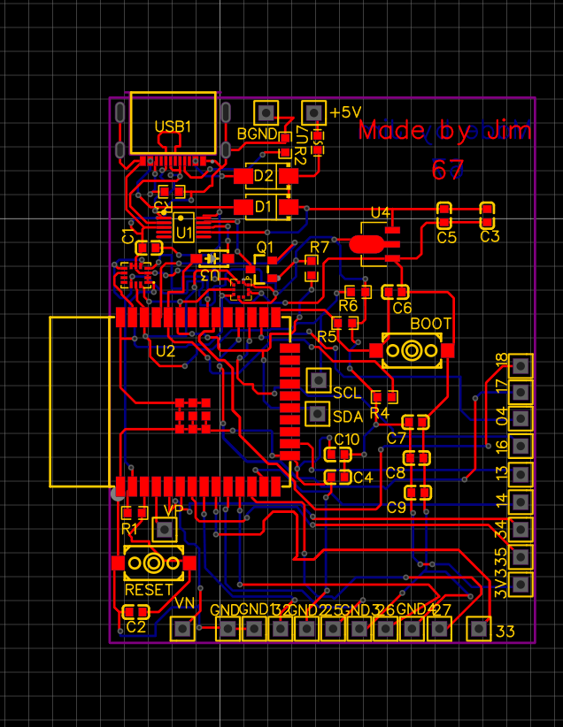
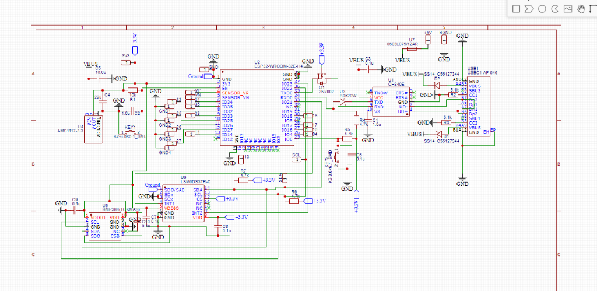

# ESP32 DIY Drone Flight Controller (FC) 🛸

A custom, low-cost drone flight controller development board designed in **EasyEDA Standard (v6.5.51)** around the **ESP32-WROOM-32E** microcontroller. Optimized for hobby quadcopter/multirotor development and 2-layer fabrication via **JLCPCB**.

---

## 📸 Hardware Overview

| PCB Routing & Layout | Schematic Capture |
| :---: | :---: |
|  |  |

---

## ✨ Key Features & Specifications

- **Microcontroller**: Espressif **ESP32-WROOM-32E-H4** (Dual-core 240 MHz, Wi-Fi & Bluetooth, onboard antenna).
- **Inertial Measurement Unit (IMU)**: STMicroelectronics **LSM6DS3TR-C** 6-axis Gyroscope & Accelerometer.
  - Interface: I2C (Address: `0x6A`, SA0 pulled to GND).
  - Interrupt lines connected to `IO19` (INT1) and `IO23` (INT2).
- **Barometer (Altitude Sensing)**: Bosch **BMP388** (Tokmas C54582187).
  - Interface: Shared I2C (Address: `0x76`, SDO pulled to GND).
- **USB-UART Interface**: WCH **CH340E** over a modern **USB-C** receptacle.
  - Bidirectional logic level shifting via **2N7002 MOSFET** (Q1) & **B0520W Schottky** (U3) on RX.
  - Standard 5.1kΩ CC pulldowns (R2, R3) for USB-C Power Delivery compatibility.
- **Power Architecture**:
  - Dual-input safe power path: External **5V DC IN** via `B+`/`B-` screw/solder terminals OR **USB-C 5V VBUS**.
  - Power isolation via dual **SS14 Schottky diodes** (D1, D2).
  - Overcurrent protection on battery input via **0603L075/12AR PTC resettable fuse** (U7, 750mA hold).
  - Regulated 3.3V system rail powered by an **AMS1117-3.3 LDO** (U4).
  - *Note: Board logic operates at 5V logic input only; motor/ESC power is decoupled and handled off-board.*
- **Expansion & Breakouts**:
  - Dedicated 4-pin I2C external expansion header (`3V3`, `SDA`, `SCL`, `GND`).
  - Standard 2.54mm pitch headers for motor PWM signals and battery voltage monitoring.

---

## 📌 Pinout & Hardware Mapping

### 1. Motor Outputs (PWM / DShot / OneShot)
| Signal / Function | ESP32 GPIO | Header Pin Label | Description |
| :--- | :--- | :--- | :--- |
| Motor 1 PWM | `IO25` | `25` | ESC Signal Output 1 |
| Motor 2 PWM | `IO26` | `26` | ESC Signal Output 2 |
| Motor 3 PWM | `IO27` | `27` | ESC Signal Output 3 |
| Motor 4 PWM | `IO32` | `32` | ESC Signal Output 4 |

### 2. Sensor Bus (I2C)
| Line | ESP32 GPIO | Pull-Up Resistor | Connected Peripherals |
| :--- | :--- | :--- | :--- |
| **SDA** | `IO21` | 4.7kΩ (`R7` to 3.3V) | LSM6DS3TR-C, BMP388, External Header |
| **SCL** | `IO22` | 4.7kΩ (`R6` to 3.3V) | LSM6DS3TR-C, BMP388, External Header |
| **IMU INT1** | `IO19` | — | LSM6DS3TR-C Data-Ready / Motion Interrupt |
| **IMU INT2** | `IO23` | — | LSM6DS3TR-C Secondary Interrupt |

### 3. Voltage Sensing & Analog Inputs
| Signal / Function | ESP32 GPIO | Type | Description |
| :--- | :--- | :--- | :--- |
| **BATT_SENSE** | `IO34` | Input-only (ADC1) | External battery voltage divider input |
| **CURR_SENSE** / AUX | `IO35` | Input-only (ADC1) | Current sensor or secondary analog sense |

*Note: Strapping pins (`IO0`, `IO2`, `IO12`, `IO15`) have been carefully isolated from conflicting external breakout loads to ensure reliable boot behavior.*

### 4. Buttons & Controls
- **RESET / EN**: Tactile switch (`KEY1`) tied to `EN` with a 10kΩ pull-up (`R1`) and a 1µF RC delay capacitor (`C2`).
- **BOOT / PROG**: Tactile switch (`KEY2`) tied to `IO0` with a 4.7kΩ pull-up (`R5`) and a 0.1µF capacitor (`C6`).

---

## 🛠️ Board Specifications & Stackup

- **Dimensions**: 45.2 mm × 58.0 mm (Revision 1 Dev Board format).
- **PCB Layers**: 2-Layer FR-4 (1.6 mm thickness, 1 oz copper).
- **Component Count**: 55 components | 141 verified functional pins.
- **Design Rule Check (DRC)**:
  - Minimum clearance: 0.2 mm / ~8 mil.
  - Standard JLCPCB fabrication constraints.

---

## ⚠️ Pre-Fabrication Checklist & Revision Notes

Before sending Revision 1.0 to JLCPCB assembly, the following layout refinements are tracked:

- [ ] **Power Trace Widening**: Increase trace widths for primary supply lines (`VBUS`, `+3.3V`, `+5V_1`, `GND`) to ≥ 0.4 mm – 0.5 mm to prevent ESP32 RF transmit brownouts (peak currents reach ~350–500 mA).
- [ ] **Solid Ground Pour (Copper Area)**: Add top and bottom copper fill zones assigned to `GND` (clearance: 0.3 mm / ~12 mil) to minimize RF ground bounce and motor EMI.
- [ ] **Via Standardization**: Adjust micro-vias to JLCPCB recommended standards (Drill diameter: ≥ 0.3 mm, Pad diameter: ≥ 0.6 mm).
- [ ] **Silkscreen Touch-ups**:
  - Clarify `B+` terminal polarity label as **"5V IN"** (protects against accidental direct 2S/3S LiPo connection).
  - Add orientation markings/axes ($X, Y, Z$) for the IMU.
- [ ] **LDO Consideration (Rev 1.1)**: AMS1117-3.3 dropout voltage is ~1.1V. While working with 5V external buck input, it is tight when powered strictly from weak USB ports (~4.6V). Future iterations may drop in an ultra-low-dropout regulator (e.g., AP2112K-3.3).

---

## 🚀 Getting Started & Software Support

This flight controller is compatible with custom firmware written in C++/ESP-IDF, Arduino, or open-source flight stacks:

- **ESP-IDF / Arduino ESP32**: Full access to dual cores (Core 0: Wi-Fi/Telemetry & Logging; Core 1: High-speed PID stabilization loop).
- **Sensor Drivers**:
  - IMU: Use the `LSM6DS3` / `Adafruit_LSM6DS3` library or raw fast I2C register access (400 kHz).
  - Barometer: `Adafruit_BMP3XX` library.
- **Telemetry**: Onboard Wi-Fi and Bluetooth allow for UDP/MAVLink telemetry transmission or web-based PID tuning.

---

## 📄 License

Open-source hardware released under the [CERN Open Hardware Licence v2 - Permissive](https://ohwr.org/cernohl) (or MIT / your preferred license).
